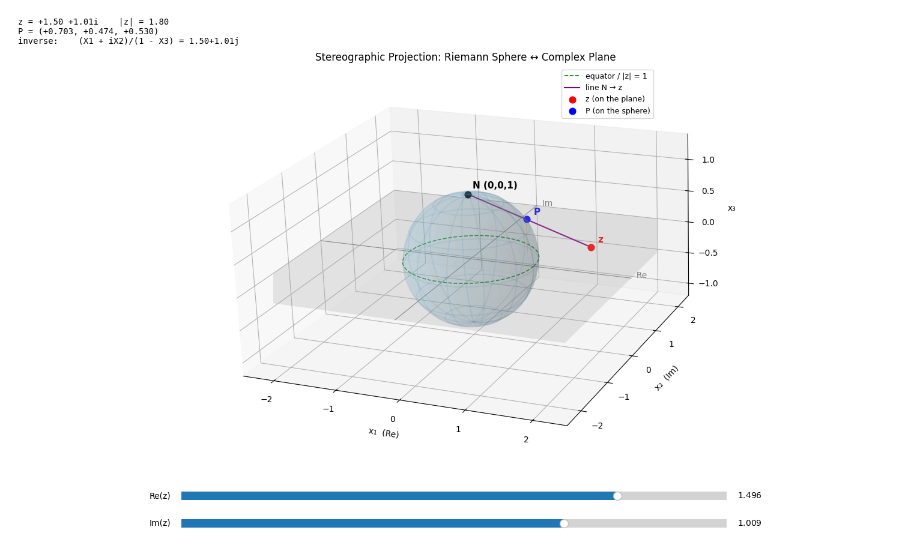

# Complex Analysis Visualizations

Interactive models I built for my complex analysis course, written in Python with matplotlib.

## Stereographic Projection



[`stereographic_projection.py`](stereographic_projection.py) shows how the complex plane maps onto the Riemann sphere.

### Interactive 3D model

- **Fully 3D:** the sphere, the plane and the projection line are drawn in 3D space.
- **Rotatable:** click and drag the plot to look at the sphere from any angle, and scroll to zoom.
- **Live sliders:** move `Re(z)` and `Im(z)` to drag z around the plane. P, the line through N, and the readout update instantly.
- **Live readout:** the top-left corner shows z, |z| and the coordinates of P, and maps P back to z with the inverse formula as a check.

### What is drawn

- **Riemann sphere:** the unit sphere $x_1^2 + x_2^2 + x_3^2 = 1$
- **Complex plane:** the plane $x_3 = 0$, where $z = x + iy \leftrightarrow (x, y, 0)$
- **North pole:** $N = (0, 0, 1)$
- **z:** a point on the plane, moved with the `Re(z)` / `Im(z)` sliders
- **P:** the point where the line from $N$ to $z$ meets the sphere

$$
P = \left( \frac{2x}{|z|^2 + 1},\ \frac{2y}{|z|^2 + 1},\ \frac{|z|^2 - 1}{|z|^2 + 1} \right),
\qquad
z = \frac{X_1 + i X_2}{1 - X_3}
$$

Things to notice while moving z:

- If $|z| < 1$, P is on the southern hemisphere.
- If $|z| = 1$, P = z, so the equator stays fixed.
- If $|z| > 1$, P is on the northern hemisphere, and P approaches N as $|z| \to \infty$. This is why N represents the point at infinity.

## Running

```bash
pip install -r requirements.txt
python3 stereographic_projection.py
```

A window opens with the 3D model. Use the sliders to move z and drag the plot to rotate it.
